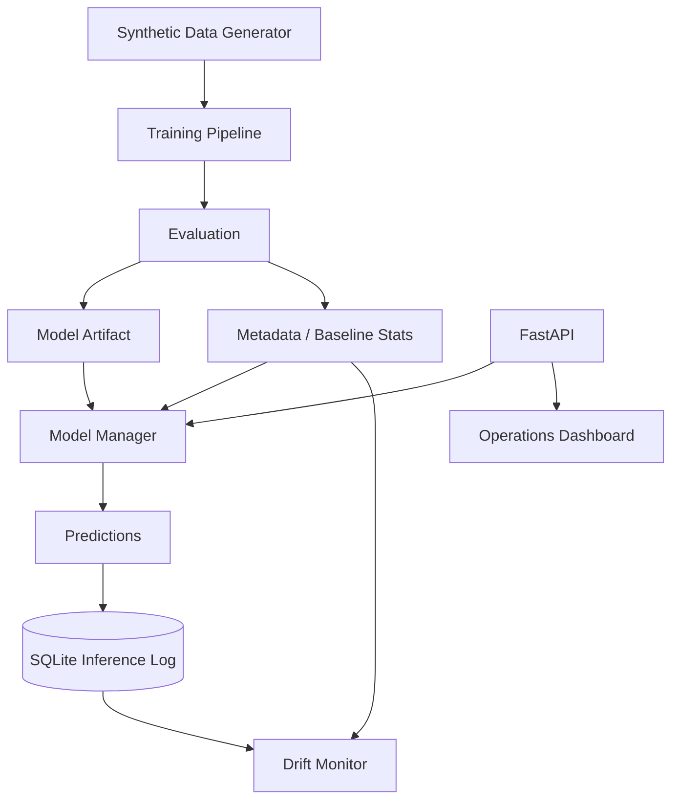

# Architecture

## Reproducibility

Training data is generated with a fixed seed and the Random Forest also uses a fixed random state. That means a reviewer can regenerate the artifact and obtain a consistent baseline rather than relying on a committed opaque binary.

## Artifact strategy

`model.joblib` and `metadata.json` are generated runtime artifacts and are intentionally excluded from Git. Metadata includes the algorithm, feature list, threshold, training/test metrics, training baseline statistics, feature importance, seed, and model version.

## Monitoring design

Inference feature values are persisted separately from the model artifact. Recent means are normalized by each feature's training standard deviation. This gives a simple, interpretable signal for distribution shift while keeping the example dependency-light.
